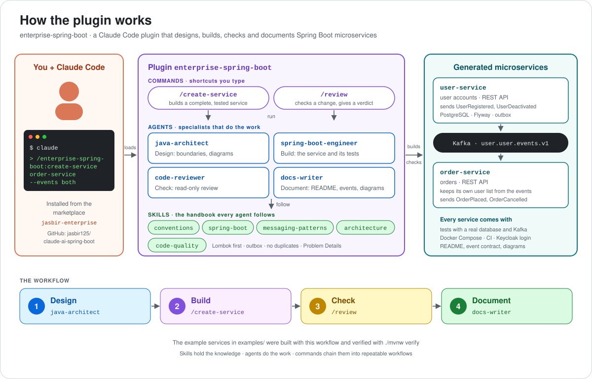
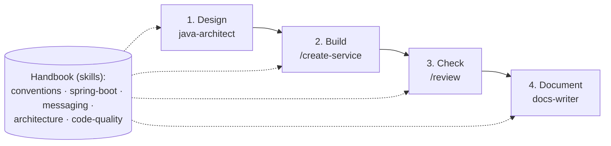
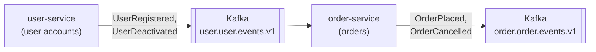

# Enterprise Spring Boot Plugin for Claude Code

## What is this?

This is an add-on (a "plugin") for **Claude Code**, the AI coding assistant that runs in your terminal.

Once installed, it teaches Claude how to build Java backend services with **Spring Boot** the way experienced teams do. That includes services that talk to each other through messages (events), not only through direct calls.

You can think of it as a **company handbook plus four specialists** that Claude follows every time:

- the handbook says *how* code must be written (the rules)
- the specialists do the work: one designs, one builds, one reviews, and one writes the documentation

It is also a **learning project**: it is small on purpose, so you can see how skills, agents, and commands work together.

Maintained by [jasbir125](https://github.com/jasbir125). Free to use under the [MIT License](LICENSE).



*You type a command in Claude Code → the plugin's agents do the work, following its skills → you get complete, tested Spring Boot services.*

## See it in action


*A real terminal session, recorded on 2 November 2026, with waiting time shortened (marked ⏩). It shows:*

1. *the installed plugin and what is inside it (agents, commands, skills);*
2. *[order-service](examples/order-service), generated by the plugin's `/create-service`, passing all its tests against real PostgreSQL and Kafka;*
3. *the plugin's `/review` catching a **deliberately bad change** (a direct `kafka.send` that skips the outbox) and answering "Request changes".*

*The commands ran in Claude Code's print mode (`claude -p`) so the session could be recorded unattended. Generating a new service takes 10–30 minutes, so it is not in the recording; the [step-by-step guide](#step-by-step-guide) shows how to run it yourself.*

---

## The three building blocks (in plain words)

| Piece | What it is | Everyday comparison | Where it lives |
|-------|-----------|---------------------|----------------|
| **Skill** | Knowledge and rules Claude reads when a topic comes up | A chapter of the handbook ("how we handle payments") | `skills/<name>/SKILL.md` |
| **Agent** | A specialist with its own job and its own limits | A team member: the architect, the developer, the reviewer, the writer | `agents/<name>.md` |
| **Command** | A shortcut you type to start a whole task | A checklist the team follows step by step | `commands/<name>.md` |

Claude picks up a **skill** by itself when your request matches it. For example, mention "Kafka" and it reads the messaging chapter. You call an **agent** or a **command** yourself.



---

## What's inside

### The four specialists (agents)

| Agent | What it does for you | What it is allowed to do |
|-------|---------------------|--------------------------|
| `java-architect` | Plans the system before any code is written: which service owns which data, when services talk directly or through events, what happens when something fails. Draws diagrams. | Reads code, writes only design documents |
| `spring-boot-engineer` | Writes the actual service following all the rules, with tests | Reads, writes, and runs the build |
| `code-reviewer` | Checks your changes and lists problems from most to least serious, with file and line | Read-only, it never changes code |
| `docs-writer` | Writes the README, the event list, and **diagrams of every flow**, all taken from the real code, and keeps them up to date | Writes documentation only |

### The handbook (skills)

| Skill | In plain words |
|-------|----------------|
| `conventions` | The house rules every piece of code must follow (listed below) |
| `spring-boot` | How to build web APIs, store data in a database, secure the service, and test it |
| `messaging-patterns` | How services send each other messages safely, without losing or doubling them |
| `architecture` | How to split a system into services and handle actions that span several services |
| `code-quality` | The checklist the reviewer uses |

### The shortcuts (commands)

| Type this | What happens |
|-----------|-------------|
| `/enterprise-spring-boot:create-service <name> --db postgres --events both` | Claude builds a complete, tested service and checks that it compiles and that all tests pass |
| `/enterprise-spring-boot:review main` | The reviewer checks what changed compared to `main` and gives a verdict: approve, approve with comments, or request changes |

---

## The house rules, in plain words

These are enforced by the `conventions` skill:

| Rule | Why it matters |
|------|----------------|
| **Respect what the project already uses** (versions, folder layout, tools) | Claude should not change your setup without asking |
| **Lombok first**: let a library write the repetitive code (getters, constructors, loggers) | Less boilerplate code to read and maintain |
| **Every error has the same clear format** (Problem Details) | Apps calling the service always know what went wrong |
| **Long lists come in pages** | One request can never return a million rows |
| **Detect lost updates**: two people editing the same record get a clear "conflict" message | Nobody silently overwrites someone else's change |
| **Database changes are versioned scripts** (Flyway) | Every environment gets exactly the same database structure |
| **Save first, send later**: a message to other services is saved together with the data change and sent afterwards (the "outbox") | If the message system is down, no message is lost and none is sent for a change that failed |
| **Expect duplicates**: a service receiving messages must handle the same message twice without harm | Message systems sometimes deliver twice, so this keeps the data correct |
| **Bad messages are set aside** (a "dead-letter" queue) after a few retries | One broken message cannot block all the others |
| **Messages are a public contract** with a fixed envelope and a version number | Other teams can rely on them, and changes do not break anyone |
| **Never wait forever** on another service (timeouts) | One slow service does not freeze the others |
| **Real tests with real databases and message brokers** (Testcontainers) | Tests show what really happens in production |
| **Diagrams are part of the code**: they are updated whenever the code changes | The pictures never lie about how the system works |

---

## Step-by-step guide

### Step 0 — What you need

- **Claude Code** installed (`claude --version` prints a version)
- **Java 21 or newer** and **Docker Desktop** (the tests start real databases in Docker)
- **Git**, and the GitHub CLI `gh` if you install the plugin from GitHub

### Step 1 — Install the plugin (one time)

Pick **one** of these ways.

**A. From GitHub** (the repository is public, so this works for anyone):

```bash
claude plugin marketplace add jasbir125/claude-ai-spring-boot
claude plugin install enterprise-spring-boot@jasbir-enterprise
```

**B. From a folder on your computer** (handy while you are changing the plugin):

```bash
claude plugin marketplace add /path/to/claude-ai-spring-boot
claude plugin install enterprise-spring-boot@jasbir-enterprise
```

> A "marketplace" is just a list of plugins. This repository is both the list (`jasbir-enterprise`) and the plugin (`enterprise-spring-boot`).

### Step 2 — Start a **new** session and check it is loaded

Plugins load only when a session **starts**. A Claude Code window that was already open will not see the plugin, so close it (`/exit`) and start fresh **in the Terminal**:

```bash
cd /path/to/your/project
claude
```

Then type:

```
/plugin
```

You should see `enterprise-spring-boot` marked **enabled**. Typing `/enterprise-spring-boot:` should list `create-service` and `review`.

> The plugin lives in Claude **Code**. It does not appear in a normal Claude chat on claude.ai or in the Claude Desktop "Chat" window. Those have their own, separate plugin lists.

### Step 3 — (Optional) Plan with the architect

```
@agent-enterprise-spring-boot:java-architect Design an order service that publishes OrderPlaced events and listens to user-service events. Draw the diagrams.
```

You get the plan, the pros and cons of each choice, and diagrams. Nothing is coded yet.

### Step 4 — Build a service

Make sure **Docker Desktop is running**, then:

```bash
mkdir my-service && cd my-service
git init -b main
claude
```

```
/enterprise-spring-boot:create-service order-service --db postgres --events both
```

> Type this **inside** the Claude session, not in the shell after `claude`. If you want to start it straight from the shell, quote it: `claude "/enterprise-spring-boot:create-service order-service --db postgres --events both"`. Without quotes, `claude` treats `--db` as its own option and stops with `unknown option '--db'`.

| Option | Meaning |
|--------|---------|
| `--db postgres` | Store data in PostgreSQL (`mysql` or `none` also work) |
| `--events produce` | The service sends messages |
| `--events consume` | The service receives messages |
| `--events both` | Both |

Claude first asks a few questions. Answer them, for example:

- **Package name:** `com.example.order`
- **Main data:** "orders with order lines"
- **Messages:** "sends OrderPlaced and OrderCancelled; listens to UserRegistered and UserDeactivated from user-service"

Then it creates everything: the code, the database scripts, tests, a `compose.yaml` that starts the database and message broker locally, a CI pipeline, a README, and the diagrams. Finally it runs `./mvnw verify` and tells you what passed.

### Step 5 — Run it on your machine

The generated README contains the exact commands. They usually look like this:

```bash
docker compose up -d --wait        # starts the database, message broker, and login server
./mvnw spring-boot:run             # starts the service
```

### Step 6 — Save your work

```bash
git add -A
git commit -m "Initial order-service"
```

### Step 7 — Make a change and get it reviewed

```bash
git switch -c my-change
# ... ask Claude for a change, or edit code yourself ...
claude
```

```
/enterprise-spring-boot:review main
```

The reviewer only reads. It lists problems by severity, each with the file and line, and ends with a verdict.

### Step 8 — Keep the documentation and diagrams current

```
@agent-enterprise-spring-boot:docs-writer update the README, docs/events.md and docs/architecture.md diagrams
```

It reads the code and redraws every diagram that changed. It never makes things up: anything it cannot confirm from the code is marked `TODO(verify)`.

### Step 9 — Update the plugin after you change it

1. Edit files in this repository and raise `version` in `.claude-plugin/plugin.json` (for example `2.0.0` → `2.0.1`).
2. Commit and push.
3. On each computer that uses the plugin:

```bash
claude plugin marketplace update jasbir-enterprise
claude plugin update enterprise-spring-boot@jasbir-enterprise
```

4. Start a new Claude Code session.

### Step 10 — Remove the plugin

```bash
claude plugin uninstall enterprise-spring-boot@jasbir-enterprise
claude plugin marketplace remove jasbir-enterprise
```

---

## When something goes wrong

| You see | What it means | What to do |
|---------|--------------|------------|
| `error: unknown option '--db'` | You typed `claude /enterprise-spring-boot:create-service … --db …` in the shell, so `claude` thinks `--db` is one of its own options | Start `claude` first and type the command inside, or put the whole command in quotes: `claude "/enterprise-spring-boot:create-service order-service --db postgres --events both"` |
| The service is created inside the plugin folder | Claude was started in `claude-ai-spring-boot` | `cd` into an empty project folder first (Step 4) |
| `Unknown command: /enterprise-spring-boot:create-service` | The session started before the plugin was installed, or you are not in Claude Code | Type `/exit`, open a **new** session in the Terminal, and check with `/plugin` |
| `Plugin "enterprise-spring-boot" not found in marketplace` | The plugin list was never added, or it is out of date | Run `claude plugin marketplace add …` (Step 1) or `claude plugin marketplace update jasbir-enterprise` |
| `Invalid marketplace source format` | The source was typed as a bare folder name | Use `./folder`, a full path, or `owner/repo` |
| `its source doesn't match its extraKnownMarketplaces entry` | Your `~/.claude/settings.json` already names a different source for `jasbir-enterprise` | Add it from that source, or change the entry in the settings file |
| The GitHub add fails with 404 or an auth error | A typo in `jasbir125/claude-ai-spring-boot`, or no network access to GitHub | Check the name and your connection, or install from a folder (Step 1 B) |
| Tests are skipped, or fail with "Could not find a valid Docker environment" | Docker is not running | Start Docker Desktop and run again |
| A database connection error mentioning a `role` | Another PostgreSQL installed on your Mac is using the same port | The generated `compose.yaml` uses ports like 15432/15433 to avoid this; check that nothing else uses them |
| The plugin does not show in Claude Desktop or claude.ai chat | Those are separate products with their own plugin lists | Use Claude Code in the Terminal |

Check that the plugin itself is valid: `claude plugin validate /path/to/claude-ai-spring-boot`. The only warning should be about `CLAUDE.md`, which is expected.

---

## Worked examples

Two services that work together. user-service announces changes to users; order-service listens to those announcements and takes orders.



### user-service

[`examples/user-service`](examples/user-service) was built with this plugin:

```
/create-service user-service --db postgres --events produce
```

It manages user accounts and announces changes ("user registered", "user deactivated") to other services. It was checked in two ways:

- **58 automated tests**, including tests against a real database and a real message broker
- a **live run**, with logins, API calls, and the messages read back from the broker

Its [README](examples/user-service/README.md) explains every part in plain language, and shows which handbook chapter produced which file. Its [diagrams](examples/user-service/docs/architecture.md) show every flow, including what happens when things go wrong.

### order-service

[`examples/order-service`](examples/order-service) was built **entirely by the installed plugin** in a fresh Claude Code session:

```
/enterprise-spring-boot:create-service order-service --db postgres --events both
```

It takes orders and **listens to user-service**: it keeps its own list of known users from user-service's messages, so it never has to call user-service directly.
- Only active users can order; anyone else gets a clear "not eligible" error (422).
- When a user is deactivated, their open orders are cancelled automatically, and order-service announces each cancellation.
- The same message arriving twice is handled once. A broken message is set aside in a dead-letter channel, without blocking the others.

It was checked by running `./mvnw verify` again outside the plugin session: **112 unit and slice tests and 16 tests against a real database and Kafka**, all passing, with 96 % of lines covered. See its [README](examples/order-service/README.md), [messages](examples/order-service/docs/events.md) and [diagrams](examples/order-service/docs/architecture.md).

---

## Folder map

```
.
├── .claude-plugin/          # plugin.json (name, version) and marketplace.json (the plugin list)
├── agents/                  # the four specialists
├── commands/                # the two shortcuts: create-service, review
├── skills/                  # the handbook
│   ├── conventions/         #   house rules
│   ├── spring-boot/         #   web, data, security, testing guides
│   ├── messaging-patterns/  #   messages between services (outbox, Kafka, contracts)
│   ├── architecture/        #   splitting systems, multi-service actions (sagas), decision records
│   └── code-quality/        #   the review checklist
├── examples/
│   ├── user-service/        # sends user messages (built with the plugin's rules)
│   └── order-service/       # listens to user messages, takes orders (built by the installed plugin)
├── docs/                    # images and media used by this README
├── CLAUDE.md                # instructions for Claude when working on this plugin (not installed with it)
├── README.md                # this file
└── LICENSE                  # MIT
```

## Words you will see

| Word | Meaning |
|------|---------|
| **Service / microservice** | A small program that owns one part of the business (users, orders) and its own data |
| **Event / message** | A note one service publishes to say "this happened", for example "order placed" |
| **Kafka** | The message system ("broker") that stores and delivers those notes |
| **Topic** | A named channel in Kafka, like `order.order.events.v1` |
| **Outbox** | A table where messages wait until they are safely sent |
| **Inbox** | A table that remembers which messages were already handled, so duplicates are ignored |
| **Dead-letter topic (DLT)** | Where messages go when they cannot be processed, so someone can look at them later |
| **Projection** | A local copy of another service's data, kept up to date by its messages |
| **Saga** | A multi-step business action across services, with an "undo" step for each one |
| **Flyway migration** | A numbered script that changes the database structure |
| **Testcontainers** | Starts real databases and brokers in Docker during tests |
| **Problem Details** | A standard format for error responses |
| **ADR** | Architecture Decision Record: a short note explaining an important decision and why it was made |

## Author

Created by Jasbir Singh ([jasbir125](https://github.com/jasbir125)).

## License

[MIT](LICENSE): use, copy, change and share it freely; keep the copyright notice.
