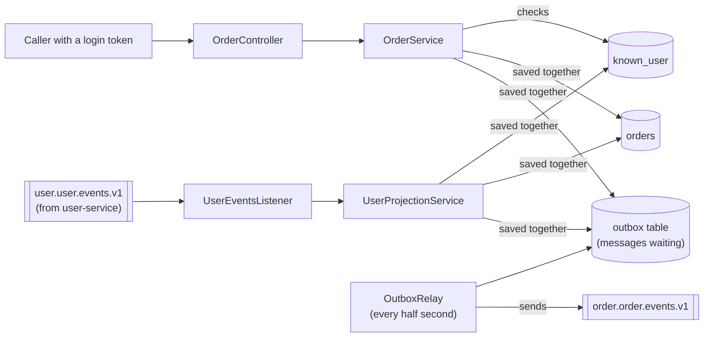

# order-service

## What is this?

A small, complete backend service that **takes orders**: a user orders one or more items in one currency, and an order can later be cancelled.

It works together with [user-service](../user-service/README.md) **without ever calling it**. user-service announces new and deactivated users as messages (*events*); order-service listens and keeps its own short list of users (`known_user`). Only users that list shows as **active** may order. When user-service deactivates a user, order-service **cancels that user's open orders** automatically. Every placed or cancelled order is announced as a message for other services, such as billing or shipping.

It was built with this plugin's `/create-service order-service --db postgres --events both` command. Use it to **see how the plugin's rules turn into real code**, including the receiving side of events (duplicates, retries, dead-letter channel). The table at the end shows which rule produced which file.

Version 1.0.0 · Spring Boot 4.1.2 · Java 25 · Maven

## How it works, in one picture



In plain words:

1. user-service sends "user 42 registered". order-service writes user 42 into its own list as **active**.
2. A caller places an order for user 42. order-service checks its list, saves the order **and** the message "order placed" in **one step**: either both are saved, or neither is.
3. A background worker (the *relay*) sends waiting messages to Kafka, the message system, every half second. If Kafka is down, messages wait in the database; the caller still gets an answer straight away.
4. user-service sends "user 42 deactivated". order-service marks the user inactive and cancels the user's open orders, again together with one "order cancelled" message per order.
5. If a message arrives twice, the second copy is skipped. A message that cannot be read goes to a separate **dead-letter channel** instead of blocking the others.

More pictures, including what happens when something goes wrong: [docs/architecture.md](docs/architecture.md).

## Try it on your computer

You need **Java 25 or newer** and **Docker Desktop** running.

**1. Start the database, the message system, and the login server**

```bash
docker compose up -d --wait
```

This starts PostgreSQL (port 15433), Kafka (9092), and Keycloak, the login server (8181).

> Running user-service at the same time? Its `compose.yaml` already starts Kafka on 9092. Start user-service's stack first, then only `docker compose up -d --wait postgres keycloak` here. Both services then share one Kafka, and users you register in user-service show up here by themselves (skip step 2).

**2. Create user-service's channel** (only when user-service is not running; user-service normally creates it)

```bash
docker compose exec kafka /opt/kafka/bin/kafka-topics.sh --bootstrap-server localhost:9092 \
  --create --if-not-exists --topic user.user.events.v1 --partitions 3
```

**3. Start the service**

```bash
DB_PASSWORD=orders-local ./mvnw spring-boot:run
```

The service now listens on port 8080.

**4. Get a login token**

Every request needs a token, like a temporary key card. This one is for a local test account only:

```bash
TOKEN=$(curl -s -X POST http://localhost:8181/realms/orders/protocol/openid-connect/token \
  -d grant_type=client_credentials -d client_id=order-service-cli -d client_secret=local-cli-secret \
  | python3 -c 'import sys,json;print(json.load(sys.stdin)["access_token"])')
```

**5. Try to order for a user nobody has heard of**

```bash
curl -s -X POST http://localhost:8080/api/v1/orders \
  -H "Authorization: Bearer $TOKEN" -H 'Content-Type: application/json' \
  -d '{"userId":42,"currency":"EUR","lines":[{"sku":"BOOK-1","quantity":2,"unitPrice":12.50}]}'
```

You get `422` with `"reason":"USER_UNKNOWN"`: order-service has not received any message about user 42 yet.

**6. Play user-service: announce user 42**

```bash
echo '42:{"eventId":"5f0c2a8e-1b7d-4c3a-9e2f-0a1b2c3d4e5f","eventType":"UserRegistered","schemaVersion":1,"occurredAt":"2026-11-02T10:00:00Z","source":"user-service","aggregateId":"42","correlationId":"demo-1","causationId":null,"payload":{"userId":42,"email":"ada@example.com","displayName":"Ada","registeredAt":"2026-11-02T10:00:00Z","version":0}}' \
  | docker compose exec -T kafka /opt/kafka/bin/kafka-console-producer.sh --bootstrap-server localhost:9092 \
      --topic user.user.events.v1 --reader-property parse.key=true --reader-property key.separator=:
```

Run step 5 again: now you get `201 Created` and the order, with the totals computed by the service.

**7. Announce that user 42 was deactivated**

```bash
echo '42:{"eventId":"6a1d3b9f-2c8e-4d4b-8f3a-1b2c3d4e5f60","eventType":"UserDeactivated","schemaVersion":1,"occurredAt":"2026-11-02T10:05:00Z","source":"user-service","aggregateId":"42","correlationId":"demo-2","causationId":null,"payload":{"userId":42,"deactivatedAt":"2026-11-02T10:05:00Z","version":1}}' \
  | docker compose exec -T kafka /opt/kafka/bin/kafka-console-producer.sh --bootstrap-server localhost:9092 \
      --topic user.user.events.v1 --reader-property parse.key=true --reader-property key.separator=:

curl -s "http://localhost:8080/api/v1/orders?userId=42" -H "Authorization: Bearer $TOKEN"
```

The order is now `CANCELLED` with reason `USER_DEACTIVATED`, and a new order for user 42 gets `422` with `"reason":"USER_NOT_ACTIVE"`.

**8. Watch the order messages in Kafka**

```bash
docker compose exec kafka /opt/kafka/bin/kafka-console-consumer.sh --bootstrap-server localhost:9092 \
  --topic order.order.events.v1 --from-beginning --formatter-property print.key=true
```

You see one `OrderPlaced` and one `OrderCancelled`, both with the order ID as key.

**9. Try the "not allowed" case**

The second test account, `order-service-reader` (secret `local-reader-secret`), may only **read**. Use its token to place or cancel an order and you get `403 Forbidden`.

**10. Stop everything**

```bash
docker compose down -v
```

## What you can ask the service (API)

All addresses start with `/api/v1/orders`. **Reading** needs the `orders.read` permission and **changing** needs `orders.write`. Errors always come back in the same standard format (Problem Details).

| What you want | Request | When it works | When it doesn't |
|---------------|---------|---------------|-----------------|
| List orders (page by page, newest first, max 100 per page) | `GET /api/v1/orders?userId=&status=&page=&size=&sort=` | 200 with one page | 400 if the status or sort field doesn't exist |
| Look up one order | `GET /api/v1/orders/{id}` | 200 | 404 not found |
| Place an order | `POST /api/v1/orders` with `userId`, `currency`, `lines[]` (`sku`, `quantity`, `unitPrice`) | 201 with `Location`, and an "OrderPlaced" message | 400 invalid input (each wrong field listed with a `code`); 422 if the user is unknown or not active |
| Cancel an order | `POST /api/v1/orders/{id}/cancel` | 200, and an "OrderCancelled" message the first time | 404; 409 if the order was changed at the same moment |

Good to know:

- **No token, or a fake one?** 401. **Right token but missing permission?** 403.
- **Money.** `currency` is an upper-case ISO 4217 code (`EUR`, `USD`, `JPY`, …). A price may not have more decimals than the currency allows: `12.50` EUR is fine, `12.505` EUR or `1.5` JPY gets `400` with code `scale`. Nothing is ever rounded. The service computes line totals and the order total itself; amounts come back with the currency's number of decimals (`25.50` EUR, `1200` JPY).
- **Limits per order:** 1–100 lines, quantity 1–1000, unit price up to 9 digits before the decimal point.
- **Why 422?** The request itself is fine, but the business rule "only active users may order" says no. `reason` tells you why: `USER_UNKNOWN` (no message about the user has arrived yet, for example right after registration) or `USER_NOT_ACTIVE`.
- Cancelling twice is harmless: the second call returns the order unchanged and sends no message.
- Error `code` values in `errors[]`: `required`, `size`, `range`, `digits`, `currency`, `scale`, `invalid`.

## Messages (events)

| Direction | Kafka channel | Messages | Key |
|-----------|---------------|----------|-----|
| Sends | `order.order.events.v1` (owned here) | `OrderPlaced`, `OrderCancelled` | order ID |
| Receives | `user.user.events.v1` (owned by user-service) | `UserRegistered`, `UserUpdated`, `UserDeactivated` | user ID |
| Sends (failures only) | `user.user.events.v1.order-service-dlt` (owned here) | Incoming messages that could not be processed, unchanged | user ID |

A message can occasionally arrive **twice** in both directions: order-service skips repeats it receives, and listeners of its own messages must do the same. Fields, examples, and the rules for future changes: [docs/events.md](docs/events.md).

## Settings

Every setting can be changed with an environment variable, so the same program runs anywhere without code changes.

| Setting | Environment variable | Default | What it is |
|---------|---------------------|---------|------------|
| `spring.datasource.url` | `DB_URL` | `jdbc:postgresql://localhost:15433/orders` | Where the database is |
| `spring.datasource.username` | `DB_USERNAME` | `orders` | Database user |
| `spring.datasource.password` | `DB_PASSWORD` | *(empty)* | **Required.** Database password (`orders-local` for the local Docker setup only) |
| `spring.kafka.bootstrap-servers` | `KAFKA_BOOTSTRAP_SERVERS` | `localhost:9092` | Where Kafka is |
| `spring.kafka.listener.concurrency` | `USER_EVENTS_CONSUMER_CONCURRENCY` | `1` | Parallel listeners per copy of the service; no more than the partitions of `user.user.events.v1` |
| `app.security.issuer-uri` | `OAUTH2_ISSUER_URI` | `http://localhost:8181/realms/orders` | **Required in production.** The login server that issues tokens |
| `app.security.audience` | `OAUTH2_AUDIENCE` | `order-service` | Tokens must be meant for this service |
| `app.messaging.order-events-topic` | `ORDER_EVENTS_TOPIC` | `order.order.events.v1` | Channel for order messages |
| `app.messaging.user-events-topic` | `USER_EVENTS_TOPIC` | `user.user.events.v1` | user-service's channel |
| `app.messaging.user-events-dlt-topic` | `USER_EVENTS_DLT_TOPIC` | `user.user.events.v1.order-service-dlt` | Dead-letter channel for unprocessable user messages |
| `app.messaging.create-topics` | `KAFKA_CREATE_TOPICS` | `true` | Create the order channel and the dead-letter channel at startup (turn off where the platform team creates channels). Never creates user-service's channel |
| `app.messaging.partitions` | `ORDER_EVENTS_PARTITIONS` | `3` | Lanes of the channels it creates |
| `app.messaging.replicas` | `ORDER_EVENTS_REPLICAS` | `1` | Copies of each message (3 or more in production) |
| `app.messaging.consumer.max-retries` | — | `4` | Retries of a failing incoming message before the dead-letter channel |
| `app.messaging.consumer.initial-interval` / `multiplier` / `max-interval` | — | `500ms` / `2.0` / `10s` | Wait between retries |
| `app.messaging.consumer.inbox-retention` | `INBOX_RETENTION` | `30d` | How long handled message IDs are remembered for duplicate detection |
| `app.messaging.consumer.inbox-cleanup-cron` | — | `0 45 * * * *` | When the inbox is cleaned (hourly) |
| `app.outbox.poll-interval-ms` | `OUTBOX_POLL_INTERVAL_MS` | `500` | How often the relay looks for waiting messages |
| `app.outbox.batch-size` | — | `100` | Messages sent per round |
| `app.outbox.send-timeout` | — | `10s` | How long to wait for Kafka to confirm a message |
| `app.outbox.retention` | — | `7d` | Sent messages older than this are deleted |
| `app.outbox.cleanup-cron` | — | `0 15 * * * *` | When sent messages are deleted (hourly) |
| `app.outbox.relay.enabled` | — | `true` | Switch the relay off for one copy of the service |

## How it is tested

```bash
./mvnw clean verify     # Docker must be running: some tests start a real database and Kafka
```

| Test | What it proves |
|------|----------------|
| `OrderTest`, `MoneyTest`, `KnownUserTest` | Totals are computed exactly at each currency's decimals and never rounded; cancelling is one-way and harmless twice; old user messages change nothing |
| `OrderServiceTest`, `UserProjectionServiceTest` | The business rules: only active users order (422 otherwise), deactivation cancels open orders once, duplicates and outdated messages are skipped |
| `OrderCreateRequestValidationTest`, `OrderControllerTest` | Every answer has the right status code and error format; tokens and permissions are checked; errors never leak internal details |
| `UserEventParserTest`, `UserEventsListenerTest` | user-service's real example messages are understood; broken ones are refused without retry; email and name are never read |
| `OutboxWriterTest`, `OutboxRelayTest`, `OrderEventPublisherTest`, `InboxCleanupTest` | Outgoing messages are built correctly, sent in order, retried after a failure; old rows are cleaned up |
| `EventContractTest` | Outgoing messages look exactly like the documented examples |
| `ArchitectureTest` | The code layers stay clean; only the relay may use `KafkaTemplate`; listeners stay thin |
| `OrderApiIT` | With a real database and Kafka: order → database → message on Kafka; currency decimals after the database round trip; 404/409/422; security; health checks; all database scripts applied |
| `UserEventsIT` | With real Kafka: users appear from messages; a duplicate message and a replay cancel an order only once; broken messages land on the dead-letter channel without blocking the next one; deactivation cancels open orders, links the "order cancelled" message to its cause, and blocks new orders |

The build also checks the Java version, bans outdated libraries, and fails if less than 80 % of lines or 70 % of branches are tested. Last run: 128 tests passed (112 unit and slice, 16 integration), 96 % of lines and 87 % of branches covered.

## Running it in production

- **Health checks**: `/actuator/health/liveness` ("is the program alive?") and `/actuator/health/readiness` ("can it serve requests?"). Readiness checks the database but **not** Kafka: the outbox covers Kafka outages for outgoing messages, and incoming ones simply wait.
- **Metrics** at `/actuator/prometheus`. Do not expose `/actuator/**` to the internet. Worth an alert:

  | Metric | What it tells you |
  |--------|-------------------|
  | `outbox_pending` | Messages waiting to be sent. Growing steadily = Kafka is unreachable |
  | `outbox_publish_failures_total` | Failed send attempts |
  | `user_events_dead_lettered_total` | Incoming messages moved to the dead-letter channel. Any increase needs a look (see below) |
  | `user_events_duplicates_total`, `user_events_skipped_total`, `user_events_applied_total` | Incoming messages skipped as repeats, skipped as unknown type/version, and applied (by type and outcome) |
  | Kafka consumer lag of group `order-service` | Incoming messages not handled yet: users may get 422 for longer than usual |

- **Something on the dead-letter channel?** Read it with the console consumer (`--topic user.user.events.v1.order-service-dlt --formatter-property print.headers=true`); the `kafka_dlt-*` headers say where it came from and why. Fix the cause first. **Do not send the message back to `user.user.events.v1`**: that channel belongs to user-service, and every other listener would receive the message again. There is no automatic replay inside order-service yet (see "Known limitations"). Until there is, ask the user-service owners to re-publish that user's current state, or fix the user's row in `known_user` by hand with a reviewed SQL change.
- **A user gets `USER_UNKNOWN` although they exist in user-service.** Usually the message has not arrived yet: check the consumer lag. If order-service started **after** Kafka already deleted that user's old messages (Kafka keeps them for 7 days by default), re-reading the channel from the start **will not help**, because the messages are gone. There is no rebuild path yet (see "Known limitations"); ask the user-service owners to re-publish the affected users.
- On shutdown it finishes running requests first (up to 30 seconds).
- Every request and every incoming message gets a **correlation ID** (`X-Correlation-Id`). It appears in the logs and in every message sent, so one action can be traced across services.
- Container image: `./mvnw spring-boot:build-image`. The CI pipeline in [.github/workflows/ci.yml](.github/workflows/ci.yml) only runs when this service has its own repository.

## Known limitations (from the plugin's code review)

The plugin's `code-reviewer` agent approved this service with comments. These points are still open:

| Area | Limitation | Planned direction |
|------|------------|-------------------|
| Rebuilding the user list | `known_user` can only be built from messages Kafka still keeps (7 days by default). A user registered earlier is unknown forever | Agree with user-service on a rebuild path, for example a compacted channel with each user's full current state or a backfill, and record it in an ADR |
| Dead-letter replay | No replay tool inside order-service | A dead-letter listener that is off by default and feeds messages back into `UserProjectionService` |
| Outbox | One message that can never be sent blocks all later ones (no attempt limit) | Set it aside after N attempts and alert |
| Timeouts | The relay waits 10 s, but the Kafka client may retry for 30 s, so some messages can be sent twice (harmless: listeners drop duplicates) | Make the relay wait longer than `delivery.timeout.ms` |
| Security | Any caller with `orders.write` can place or cancel orders for **any** user; any caller with `orders.read` can list all orders. The API is meant **only for other services**, not for end users directly | Per-user checks once end-user tokens are used |
| Tests | Token issuer and audience checks are never tested with a real decoder; the "no open orders after deactivation" locking rule has no test that runs both actions at once | Add both tests |

## Which plugin rule produced which part

| Part of the code | Where the rule comes from |
|------------------|---------------------------|
| Outbox table, `OutboxWriter`, `OutboxRelay` ("save first, send later") | `messaging-patterns` → `references/outbox.md` |
| `processed_event` inbox, `UserEventsListener`, retries and dead-letter channel (`KafkaConsumerConfig`) | `messaging-patterns` → `references/kafka.md` |
| `EventEnvelope`, the message types, example files, tolerant reading of user-service messages | `messaging-patterns` → `references/event-contracts.md` |
| `known_user` projection instead of calling user-service; data ownership | `architecture` |
| Amounts in messages as decimal strings plus ISO 4217 `currency` | `messaging-patterns` → `references/event-contracts.md` |
| `ApiExceptionHandler`, paged lists, request/response types | `conventions`, `spring-boot` → `references/web.md` |
| Database scripts, version numbers → 409 | `conventions` ("Database Schema with Flyway"), `spring-boot` → `references/data.md` |
| Row locks so ordering and deactivation cannot race (`KnownUserRepository`) | Design decision of this service, not a plugin rule (explained in [docs/architecture.md](docs/architecture.md), section 5) |
| `SecurityConfig` (login tokens, permissions) | `spring-boot` → `references/security.md` |
| Tests with a real database and Kafka, architecture tests | `spring-boot` → `references/testing.md`, `architecture` |
| `@RequiredArgsConstructor`, `@Slf4j`, `@Getter` (Lombok) | `conventions` ("Lombok first") |
| Build checks, `compose.yaml`, CI | `spring-boot-engineer` agent |
| This README, `docs/events.md`, `docs/architecture.md` | `docs-writer` agent |
