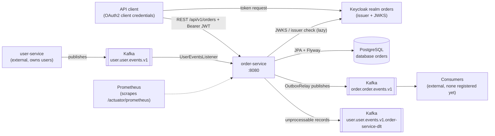
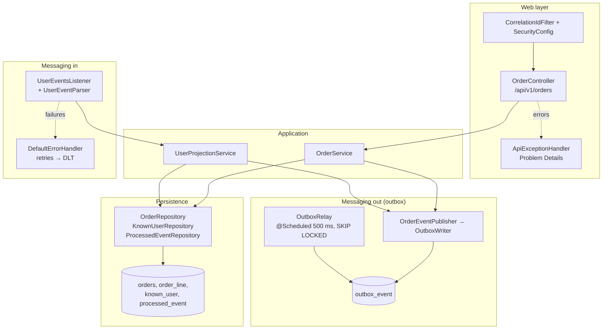
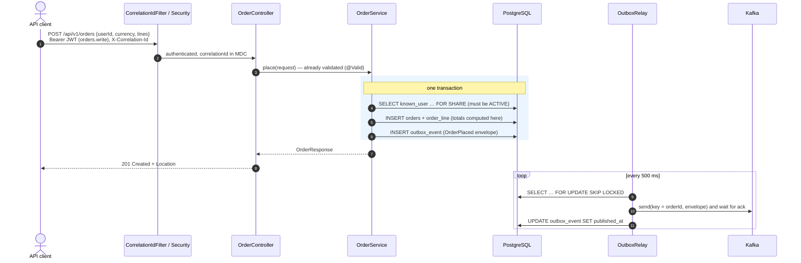
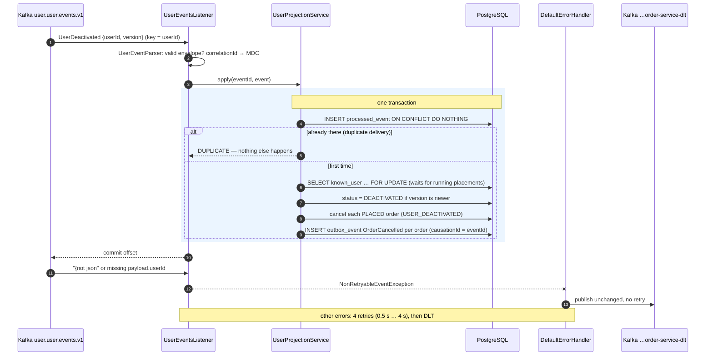
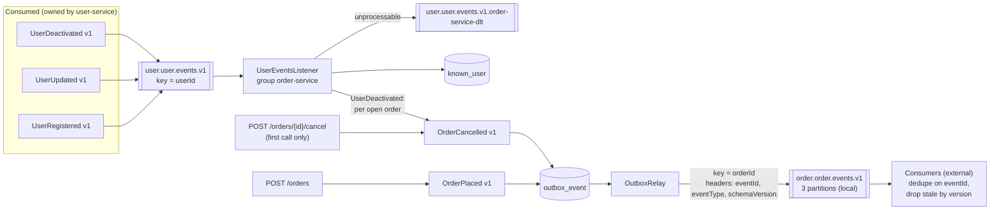
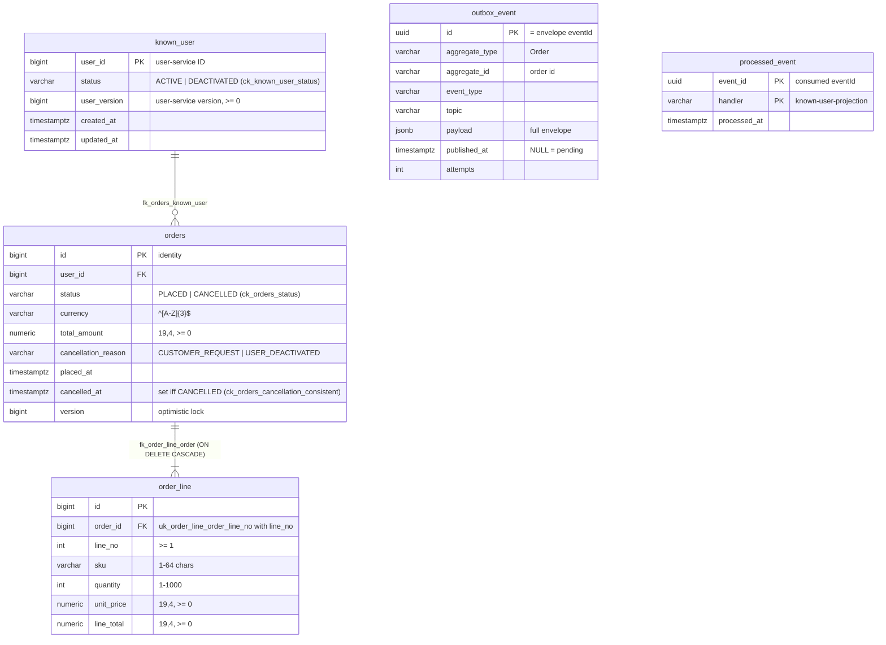
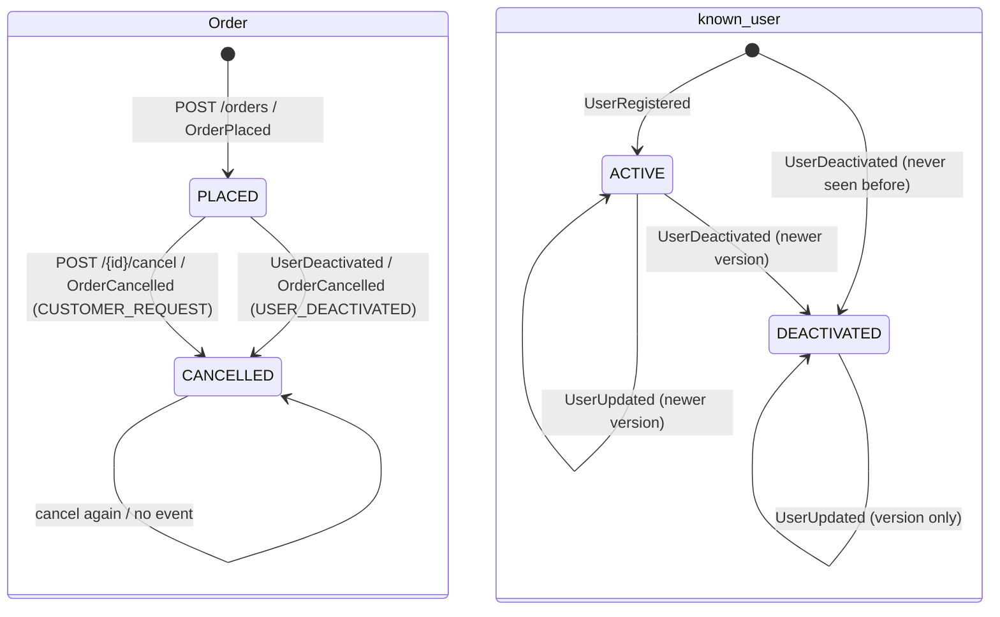

# order-service: how it is built (diagrams)

## How to read this page

Each section has a **picture** and a **plain-language explanation** under it. The pictures use the real names from the code (classes, tables, channels, messages), so a developer can find each box in the code. You can follow the explanations without knowing those names.

The `docs-writer` agent keeps these pictures up to date: any change to the code's flows, tables, or messages must update them in the same change.

Common names in the pictures:

| Name in the picture | What it is |
|---------------------|------------|
| API client | Any program that calls this service, with a login token |
| Keycloak | The login server that hands out tokens |
| PostgreSQL | The database |
| Kafka | The message system that delivers events between services |
| `known_user` | order-service's own short list of users, built only from user-service's messages |
| `outbox_event` | The table where outgoing messages wait until they are sent |
| `processed_event` | The *inbox*: IDs of incoming messages already handled, to skip duplicates |
| `OutboxRelay` | The background worker that sends waiting messages |
| DLT | Dead-letter topic: a separate channel for incoming messages that cannot be processed |

## 1. The big picture: who talks to whom



- A caller gets a **token** from the login server, then calls order-service with it.
- order-service stores orders in **its own database**. No other service reads or writes these tables.
- It **never calls user-service**. It learns about users only from user-service's messages and keeps a small local list (`known_user`). So orders can be placed even while user-service is down.
- It **announces** placed and cancelled orders on its own Kafka channel. Messages it cannot read go to its dead-letter channel.

## 2. Inside the service: the parts



Read it from top to bottom:

1. **Web layer.** Each request gets a tracking number (correlation ID) and has its token checked, then reaches `OrderController`, which only hands it on. Errors become standard error responses.
2. **Messaging in.** `UserEventsListener` reads user-service messages, checks them, and hands them to `UserProjectionService`. Failures go to the error handler (retries, then the dead-letter channel).
3. **Application.** `OrderService` places and cancels orders. `UserProjectionService` keeps the user list up to date and cancels open orders of deactivated users.
4. **Messaging out.** Both services write outgoing messages to `outbox_event` in the same database step as the change. `OutboxRelay` sends them to Kafka.

`ArchitectureTest` keeps the layers separate: for example, the controller cannot reach repositories, the domain model has no framework dependencies, and only the relay may use `KafkaTemplate`.

## 3. Placing an order: when everything goes well



Step by step:

1. The caller sends the user ID, a currency, and the lines.
2. The request is checked: valid currency, 1–100 lines, quantities 1–1000, prices with no more decimals than the currency allows.
3. Inside **one database step** (blue box), the service checks the user is known and ACTIVE, computes line totals and the total itself (never trusts the caller), saves the order, and saves the "OrderPlaced" message. The user's row is locked *for share*, so the user cannot be deactivated half-way through.
4. The caller gets `201 Created` straight away, without waiting for Kafka. The relay sends the message afterwards.

## 4. Placing and cancelling: when something goes wrong

```mermaid
sequenceDiagram
    autonumber
    actor C as API client
    participant S as Security
    participant OC as OrderController
    participant OS as OrderService
    participant DB as PostgreSQL
    participant R as OutboxRelay
    participant K as Kafka

    C->>S: request without / with invalid token
    S-->>C: 401 Unauthorized
    C->>S: POST with an orders.read-only token
    S-->>C: 403 Forbidden

    C->>OC: POST {currency: "JPY", unitPrice: 1.5}
    OC-->>C: 400 Problem Details, errors[].code = scale

    C->>OC: POST for a user not in known_user / DEACTIVATED
    OC->>OS: place
    OS->>DB: SELECT known_user FOR SHARE → missing / DEACTIVATED
    OS-->>C: 422 reason USER_UNKNOWN / USER_NOT_ACTIVE — nothing written

    C->>OC: POST /{id}/cancel at the same time as another change
    OS-->>C: 409 "Version conflict"

    R->>K: send(event)
    K--xR: broker down / timeout (10 s)
    R->>DB: attempts + 1, published_at stays NULL, batch stops (keeps order)
    note over R,K: next run retries; outbox_pending grows until Kafka is back
```

| What happened | What the caller gets | What happens inside |
|---------------|---------------------|---------------------|
| No token, or a fake one | `401 Unauthorized` | Stopped at the door |
| A read-only token used to place or cancel | `403 Forbidden` | Stopped at the door |
| Invalid input (bad currency, no lines, too many decimals…) | `400 Bad Request`, listing each wrong field with a `code` | Nothing is saved |
| The user is unknown or deactivated | `422`, with `reason` `USER_UNKNOWN` or `USER_NOT_ACTIVE` | Nothing is saved, no message |
| The order does not exist | `404 Not Found` | — |
| Two changes to the same order at once | `409 Version conflict` | The second change is refused; reload and retry |
| Kafka is down | Nothing, the caller already got its answer | The message waits in the outbox; the relay retries, keeping the order. `outbox_pending` rises |

## 5. A user is deactivated: open orders are cancelled



Step by step:

1. user-service announces that a user was deactivated.
2. The listener checks the message and hands it on.
3. In **one database step**: the message ID is recorded in the inbox (a repeat is skipped here), the user is marked DEACTIVATED, every open order of that user is cancelled, and one "OrderCancelled" message per order is saved in the outbox. The user's row is locked, so an order being placed at that very moment either finishes first (and is then cancelled) or sees the deactivation (and gets 422).
4. Only then is the message marked as read in Kafka.
5. A broken message goes to the dead-letter channel immediately; anything else that keeps failing goes there after 4 retries. The channel keeps moving either way.

## 6. Which message causes which



- **Incoming:** user-service's three messages update `known_user`. Unreadable ones go to the dead-letter channel.
- **Outgoing:** placing an order sends "OrderPlaced". Cancelling sends "OrderCancelled", either from the API (once per order) or for each open order when its user is deactivated.

Contents of each message: [events.md](events.md).

## 7. What is stored in the database



- **`known_user`**: one row per user order-service has heard of. No names or emails: only "may this user order?" and the last version seen.
- **`orders`** and **`order_line`**: an order and its lines. The database itself enforces the rules: valid status, a cancelled order always has a reason and a time, quantities and amounts in range. Amounts are stored with 4 decimals; the service always returns them with the currency's own number of decimals.
- **`outbox_event`**: outgoing messages; sent ones are deleted after 7 days. Linked to orders by `aggregate_id` only (no database link).
- **`processed_event`**: IDs of handled incoming messages; deleted after 30 days.

Created by `V1__create_known_user_and_orders.sql` and `V2__create_outbox_event_and_processed_event.sql`.

## 8. The life of an order and of a known user



- An order starts **PLACED** and can only move to **CANCELLED**, once. Cancelling again changes nothing and sends nothing.
- A known user starts **ACTIVE** when registered. Deactivation is final, because user-service has no way to reactivate a user. Older or repeated messages change nothing.
