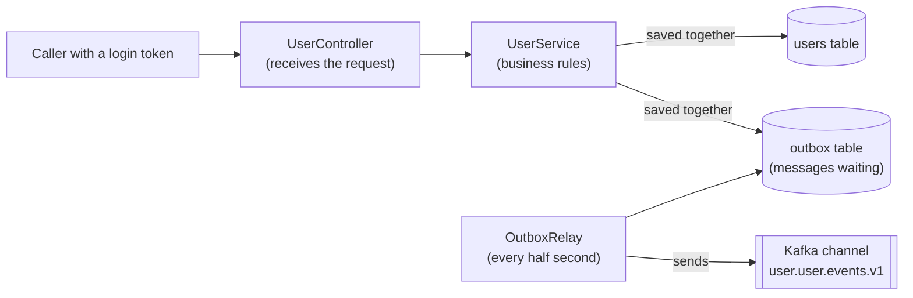

# user-service

## What is this?

A small, complete backend service that **keeps a list of user accounts**: people can be registered, have their details changed, and be deactivated.

Every time something changes, it **tells other services** by publishing a short message (an *event*), for example "user 42 was registered". Other services, such as an order service, listen to these messages and keep their own copy of what they need. They never have to call this service directly.

It was built with this plugin's `/create-service user-service --db postgres --events produce` command. Use it to **see how the plugin's rules turn into real code**. The table at the end shows which rule produced which file.

Version 1.0.1 · Spring Boot 4.1.2 · Java 25 · Maven

## How it works, in one picture



In plain words:

1. A caller asks to register a user.
2. The service saves the user **and** the message "user registered" in the database, in **one step**. Either both are saved, or neither is.
3. A background worker (the *relay*) picks up waiting messages every half second and sends them to Kafka, the message system.
4. If Kafka is down, nothing is lost: messages wait in the database and go out when Kafka is back. The caller still gets an answer straight away.

More pictures, including what happens when something goes wrong: [docs/architecture.md](docs/architecture.md).

## Try it on your computer

You need **Java 25 or newer** and **Docker Desktop** running.

**1. Start the database, the message system, and the login server**

```bash
docker compose up -d --wait
```

This starts PostgreSQL (port 15432), Kafka (9092), and Keycloak, the login server (8180).

**2. Start the service**

```bash
DB_PASSWORD=users-local ./mvnw spring-boot:run
```

The service now listens on port 8080.

**3. Get a login token**

Every request needs a token, like a temporary key card. This one is for a local test account only:

```bash
TOKEN=$(curl -s -X POST http://localhost:8180/realms/demo/protocol/openid-connect/token \
  -d grant_type=client_credentials -d client_id=user-service-cli -d client_secret=local-cli-secret \
  | python3 -c 'import sys,json;print(json.load(sys.stdin)["access_token"])')
```

**4. Register a user**

```bash
curl -i -X POST http://localhost:8080/api/v1/users \
  -H "Authorization: Bearer $TOKEN" -H 'Content-Type: application/json' -H 'X-Correlation-Id: demo-1' \
  -d '{"email":"ada@example.com","displayName":"Ada Lovelace"}'
```

You get back `201 Created` and the new user.

**5. Watch the messages arrive in Kafka**

```bash
docker compose exec kafka /opt/kafka/bin/kafka-console-consumer.sh --bootstrap-server localhost:9092 \
  --topic user.user.events.v1 --from-beginning --property print.key=true
```

**6. Try the "not allowed" case**

The second test account, `user-service-reader` (secret `local-reader-secret`), may only **read**. Use its token to register a user and you get `403 Forbidden`.

**7. Stop everything**

```bash
docker compose down -v
```

## What you can ask the service (API)

All addresses start with `/api/v1/users`. **Reading** needs the `users.read` permission and **changing** needs `users.write`. Errors always come back in the same standard format (Problem Details).

| What you want | Request | When it works | When it doesn't |
|---------------|---------|---------------|-----------------|
| List users (page by page, max 100 per page) | `GET /api/v1/users?status=&page=&size=&sort=` | 200 with one page | 400 if the status or sort field doesn't exist |
| Look up one user | `GET /api/v1/users/{id}` | 200 | 404 not found |
| Register a user | `POST /api/v1/users` with `email`, `displayName` | 201, and a "UserRegistered" message is sent | 400 invalid input (each wrong field is listed); 409 if the email is already used |
| Change details | `PUT /api/v1/users/{id}` with `email`, `displayName`, `version` | 200, and a "UserUpdated" message if something really changed | 400, 404, or 409 if someone else changed the user first or the email is taken |
| Deactivate | `POST /api/v1/users/{id}/deactivate` | 200, and a "UserDeactivated" message the first time | 404 |

Good to know:

- **No token, or a fake one?** You get 401. **Right token but missing permission?** You get 403.
- Emails are stored in lower case. `ADA@example.com` and `ada@example.com` count as the same email.
- **What is `version` for?** Every user has a version number that goes up with each change. When you update, you send the version you last saw. If someone changed the user in between, you get **409 Conflict** instead of silently overwriting their change. Reload and try again.

## The messages this service sends

They go to the Kafka channel `user.user.events.v1`. Each message uses the user's ID as its key, so all messages about one user stay in order. A message can occasionally arrive **twice**, so listeners must handle that. Details and examples: [docs/events.md](docs/events.md).

## Settings

Every setting can be changed with an environment variable, so the same program runs anywhere without code changes.

| Setting | Environment variable | Default | What it is |
|---------|---------------------|---------|------------|
| `spring.datasource.url` | `DB_URL` | `jdbc:postgresql://localhost:15432/users` | Where the database is |
| `spring.datasource.username` | `DB_USERNAME` | `users` | Database user |
| `spring.datasource.password` | `DB_PASSWORD` | *(empty)* | **Required.** Database password (`users-local` for the local Docker setup) |
| `spring.kafka.bootstrap-servers` | `KAFKA_BOOTSTRAP_SERVERS` | `localhost:9092` | Where Kafka is |
| `app.security.issuer-uri` | `OAUTH2_ISSUER_URI` | `http://localhost:8180/realms/demo` | **Required in production.** The login server that issues tokens |
| `app.security.audience` | `OAUTH2_AUDIENCE` | `user-service` | Tokens must be meant for this service |
| `app.messaging.user-events-topic` | `USER_EVENTS_TOPIC` | `user.user.events.v1` | Kafka channel name |
| `app.messaging.create-topics` | `KAFKA_CREATE_TOPICS` | `true` | Create the channel at startup (turn off where the platform team creates channels) |
| `app.messaging.partitions` | `USER_EVENTS_PARTITIONS` | `3` | How many lanes the channel has (only used when creating it) |
| `app.messaging.replicas` | `USER_EVENTS_REPLICAS` | `1` | Copies of each message (use 3 or more in production) |
| `app.outbox.poll-interval-ms` | `OUTBOX_POLL_INTERVAL_MS` | `500` | How often the relay looks for waiting messages |
| `app.outbox.batch-size` | — | `100` | Messages sent per round |
| `app.outbox.send-timeout` | — | `10s` | How long to wait for Kafka to confirm a message |
| `app.outbox.retention` | — | `7d` | Sent messages older than this are cleaned up every hour |
| `app.outbox.relay.enabled` | — | `true` | Switch the relay off for one copy of the service |

## How it is tested

```bash
./mvnw clean verify     # Docker must be running: some tests start a real database and Kafka
```

| Test | What it proves |
|------|----------------|
| `UserServiceTest` | The business rules: emails are cleaned up, duplicates are refused, outdated versions are refused, deactivating twice is harmless, no message when nothing changed |
| `UserControllerTest` | Every answer has the right status code and error format; tokens and permissions are checked; error messages never leak internal details |
| `OutboxWriterTest`, `OutboxRelayTest`, `UserEventPublisherTest` | Messages are built correctly, sent in order, and retried after a failure; old ones are cleaned up |
| `EventContractTest` | The messages look exactly like the documented examples, so other teams can rely on them |
| `ArchitectureTest` | The code layers stay clean, and only the relay may talk to Kafka |
| `UserApiIT` | The whole journey with a real database and real Kafka: request → database → message on Kafka, in order, plus conflicts, security, and health checks |

The build also checks the Java version, bans outdated libraries, and fails if less than 80 % of lines or 70 % of branches are tested. Currently 58 tests pass.

## Running it in production

- **Health checks** for the platform: `/actuator/health/liveness` ("is the program alive?") and `/actuator/health/readiness` ("can it serve requests?"). Readiness checks the database but **not** Kafka, because the outbox covers Kafka outages.
- **Metrics** at `/actuator/prometheus`, including `outbox_pending` (messages waiting to be sent). If that number keeps growing, Kafka is unreachable. Do not expose `/actuator/**` to the internet.
- On shutdown it finishes running requests first (up to 30 seconds).
- Every request gets a **correlation ID** (`X-Correlation-Id`). It appears in the logs and in every message sent, so one user action can be traced across services.
- Container image: `./mvnw spring-boot:build-image`. The CI pipeline in [.github/workflows/ci.yml](.github/workflows/ci.yml) only runs when this service has its own repository.

## Which plugin rule produced which part

| Part of the code | Where the rule comes from |
|------------------|---------------------------|
| Outbox table, `OutboxWriter`, `OutboxRelay` ("save first, send later") | `messaging-patterns` → `references/outbox.md` |
| `EventEnvelope`, the message types, the example files | `messaging-patterns` → `references/event-contracts.md` |
| Kafka sender settings (wait for confirmation, no duplicates from retries) | `messaging-patterns` → `references/kafka.md` |
| `ApiExceptionHandler`, paged lists, request/response types | `conventions`, `spring-boot` → `references/web.md` |
| Database scripts, version numbers → 409 conflicts | `conventions` ("Database Schema with Flyway"), `spring-boot` → `references/data.md` |
| `SecurityConfig` (login tokens, permissions) | `spring-boot` → `references/security.md` |
| Tests with a real database and Kafka, architecture tests | `spring-boot` → `references/testing.md`, `architecture` |
| `@RequiredArgsConstructor`, `@Slf4j`, `@Getter` (Lombok) | `conventions` ("Lombok first") |
| Build checks, `compose.yaml`, CI | `spring-boot-engineer` agent |
| Health checks, metrics, correlation ID | `conventions` (Quality Bar, "Correlation") |
| This README, `docs/events.md`, `docs/architecture.md` | `docs-writer` agent |
