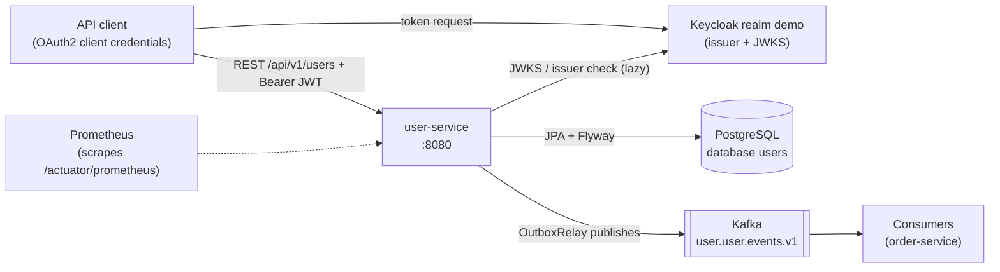
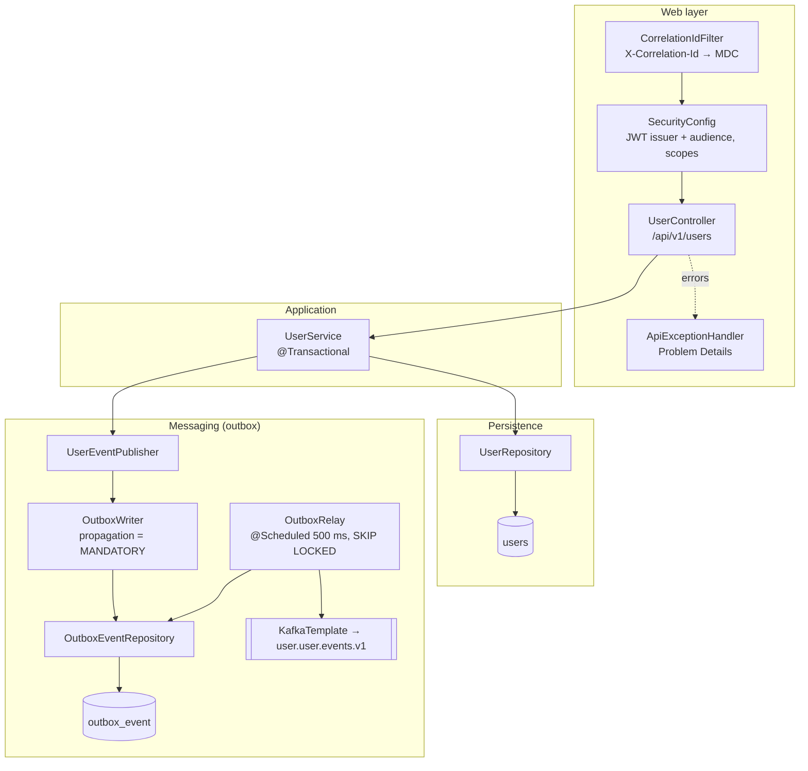
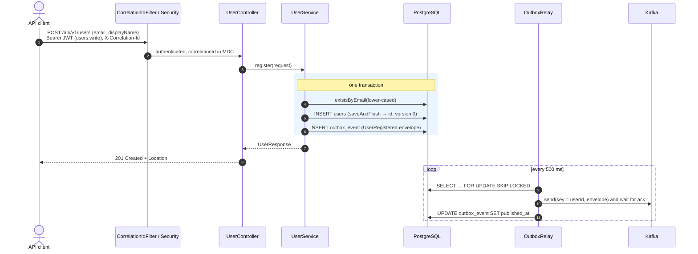
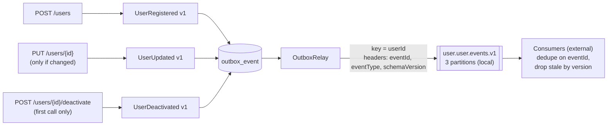
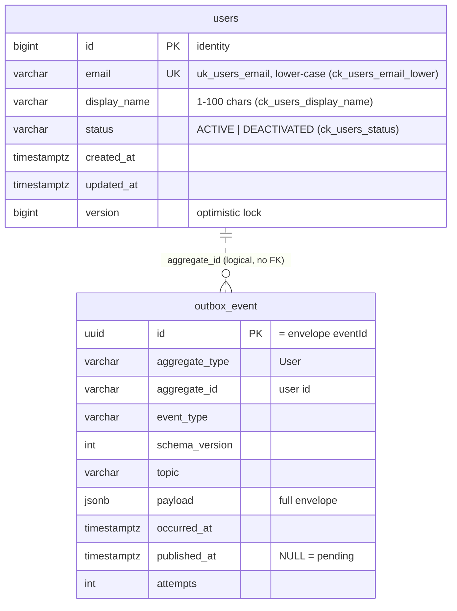
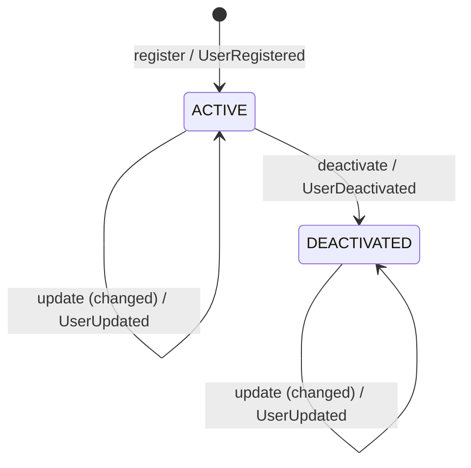

# user-service: how it is built (diagrams)

## How to read this page

Each section has a **picture** and a **plain-language explanation** under it. The pictures use the real names from the code (classes, tables, channels, messages), so a developer can find each box in the code. You can follow the explanations without knowing those names.

The `docs-writer` agent keeps these pictures up to date: any change to the code's flows, tables, or messages must update them in the same change.

Common names in the pictures:

| Name in the picture | What it is |
|---------------------|------------|
| API client | Any program that calls this service, with a login token |
| Keycloak | The login server that hands out tokens |
| PostgreSQL | The database |
| Kafka | The message system that delivers events to other services |
| `outbox_event` | The table where messages wait until they are sent |
| `OutboxRelay` | The background worker that sends waiting messages |

## 1. The big picture: who talks to whom



- A caller first gets a **token** from the login server, then calls user-service with it.
- user-service checks the token against the login server's public keys. It only fetches them when the first request arrives, so it can start even if the login server is still starting.
- It stores users in **its own database**. No other service reads or writes these tables.
- It **announces changes** on Kafka. Other services listen there; today that is order-service.
- **Prometheus**, the monitoring system, regularly collects numbers from the service (dotted line).

## 2. Inside the service: the parts



Read it from top to bottom:

1. **Web layer.** Every request first gets a tracking number (correlation ID) and has its token checked. It then reaches the `UserController`, which only receives requests and hands them on. Any error becomes a standard error response (`ApiExceptionHandler`).
2. **Application.** `UserService` holds the business rules ("an email can only be used once").
3. **Persistence.** The user is saved in the `users` table.
4. **Messaging.** In the same step, the message is written to the `outbox_event` table. Separately, `OutboxRelay` sends waiting messages to Kafka every half second.

An automatic test (`ArchitectureTest`) makes sure the layers stay separate. For example, only the relay may send to Kafka.

## 3. Registering a user: when everything goes well



Step by step:

1. The caller sends the new user's email and name, with a token that allows writing.
2. The request is checked and gets a tracking number.
3. Inside **one database step** (the blue box), the service checks that the email isn't taken, saves the user, and saves the "UserRegistered" message.
4. The caller immediately gets `201 Created`. It does **not** wait for Kafka.
5. Separately, the relay picks up the waiting message, sends it to Kafka, waits until Kafka confirms, and marks it as sent. If several copies of the service run, each one skips messages another copy is already sending (`SKIP LOCKED`).

## 4. When something goes wrong

```mermaid
sequenceDiagram
    autonumber
    actor C as API client
    participant S as Security
    participant UC as UserController
    participant US as UserService
    participant DB as PostgreSQL
    participant R as OutboxRelay
    participant K as Kafka

    C->>S: request without / with invalid token
    S-->>C: 401 Unauthorized
    C->>S: POST with a users.read-only token
    S-->>C: 403 Forbidden

    C->>UC: POST {email: "not-an-email"}
    UC-->>C: 400 Problem Details, errors[].code = email

    C->>UC: POST with an email already in use
    UC->>US: register
    US->>DB: existsByEmail → true (or uk_users_email violation on a race)
    US-->>C: 409 "Email already in use" — transaction rolled back, no outbox row

    C->>UC: PUT /{id} with a stale version
    UC->>US: update
    US-->>C: 409 "Version conflict"

    R->>K: send(event)
    K--xR: broker down / timeout (10 s)
    R->>DB: attempts + 1, published_at stays NULL, batch stops (keeps order)
    note over R,K: next run retries; outbox_pending metric grows until Kafka is back
```

| What happened | What the caller gets | What happens inside |
|---------------|---------------------|---------------------|
| No token, or a fake one | `401 Unauthorized` | The request is stopped at the door |
| A token that may only read, used to write | `403 Forbidden` | The request is stopped at the door |
| Invalid input, for example a broken email | `400 Bad Request`, listing each wrong field | Nothing is saved |
| The email is already used | `409 Conflict` | Nothing is saved and **no message is sent**. If two people register the same email at the same moment, the database itself blocks the second one |
| Updating with an old version number | `409 Version conflict` | Someone else changed the user first; reload and try again |
| Kafka is down | Nothing, the caller already got its answer | The message stays in the outbox and the relay retries until Kafka is back. Messages stay in order. The `outbox_pending` number in monitoring rises, which is the alarm signal |

## 5. Which action sends which message



- **Register** → "UserRegistered". **Change details** → "UserUpdated", but only if something really changed. **Deactivate** → "UserDeactivated", only the first time.
- All messages pass through the outbox and the relay, and land on the Kafka channel `user.user.events.v1`.
- Listeners must skip messages they have already handled (by `eventId`) and ignore outdated ones (by `version`).

What each message contains: [events.md](events.md).

## 6. What is stored in the database



- **`users`**: one row per user. The database itself enforces the rules: the email is unique and lower case, the name is 1–100 characters, and the status is ACTIVE or DEACTIVATED. `version` counts changes, which is how conflicting edits are detected.
- **`outbox_event`**: one row per message. `published_at` is empty until the message is sent, and `attempts` counts send tries. Sent messages are deleted after 7 days.
- The dotted line means "belongs to the same user", but there is no hard database link between the tables.

The tables are created by the scripts `V1__create_users.sql` and `V2__create_outbox_event.sql`.

## 7. The life of a user



- A new user starts as **ACTIVE**.
- Details can be changed at any time, and each real change sends "UserUpdated".
- Deactivating moves the user to **DEACTIVATED** and sends "UserDeactivated". Doing it again changes nothing and sends nothing.
- There is no way back to ACTIVE yet.
- **Open question:** a deactivated user can currently still have their details changed. Whether that should be allowed is a product decision (`TODO(verify)`).
